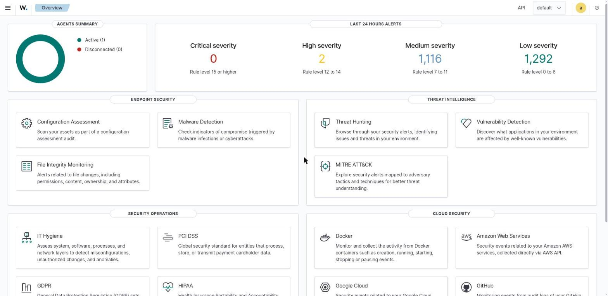
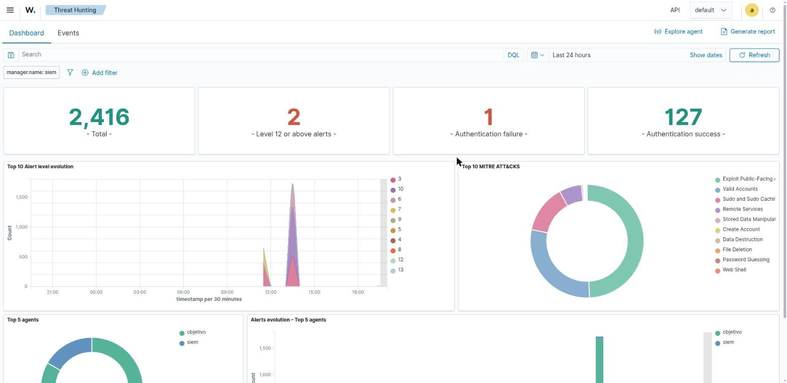
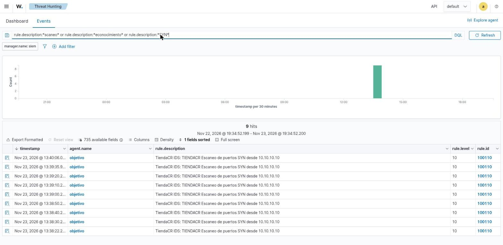
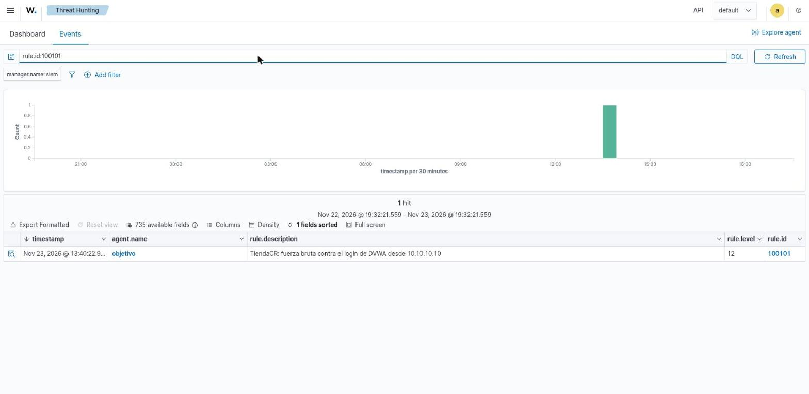
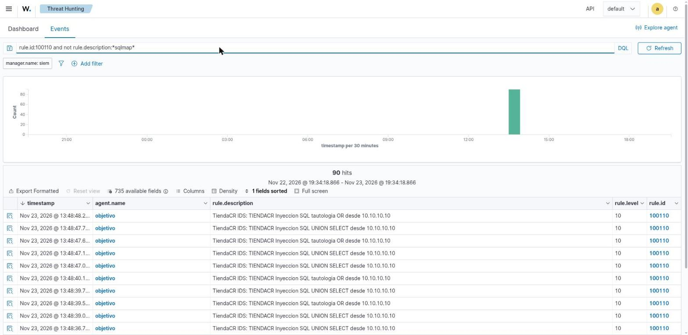
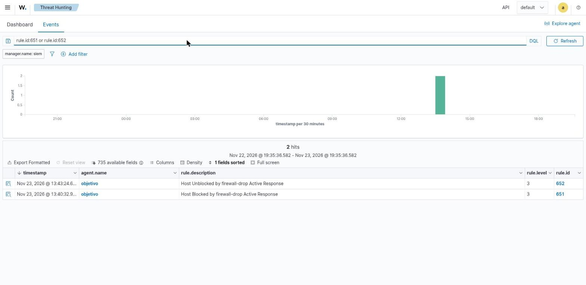

# Mini SOC — TiendaCR

SOC mínimo para la tienda ficticia **TiendaCR** (curso ITI-922, Proyecto 2): un servidor web
vulnerable protegido con control de acceso, monitoreado con IDS (Suricata) y SIEM/HIDS (Wazuh),
atacado de forma controlada y con respuesta automática.

> ⚠️ **Solo para laboratorio.** Ataque únicamente estas máquinas, que usted mismo crea. La
> aplicación es deliberadamente vulnerable: nunca la exponga a Internet.

## Arquitectura

```
  Laptop (host KVM) 10.10.10.1 ──┐  SSH admin + panel Wazuh
                                 │
   ┌──── Red interna soc-net (10.10.10.0/24) ────┐
   ▼                 ▼                            ▼
 Kali 10.10.10.10   Objetivo 10.10.10.20        SIEM 10.10.10.30
 nmap/hydra/sqlmap  DVWA + Suricata + agente    Wazuh (manager+indexer+dashboard)
 (contenedor)       Wazuh + UFW                 + UFW
                         └── alertas 1514/1515 ──▶
                    Respuesta automática: el manager ordena al agente
                    bloquear la IP atacante en el firewall (firewall-drop).
```

## Requisitos (host)

- Linux con **KVM/libvirt** (`libvirt-daemon-system`, `qemu-system-x86`, `virtinst`, `xorriso`),
  ≥ 12 GB de RAM libres y ~60 GB de disco.
- Una llave SSH para el laboratorio:
  ```bash
  ssh-keygen -t ed25519 -f ~/.ssh/minisoc_ed25519 -N '' -C minisoc-lab
  ```

## Despliegue (reproducir desde cero)

```bash
# 0. Imágenes base en vm/ (Ubuntu 24.04 cloud); ver vm/DESCARGAR.md
# 1. Red + 3 VM (cloud-init, SSH solo con llave)
sudo systemctl enable --now libvirtd
./infra/crear-vms.sh

# 2. Instalar cada máquina (copia su carpeta y corre su setup.sh)
./infra/provisionar.sh siem       # Wazuh all-in-one (~8 min)
./infra/provisionar.sh objetivo   # DVWA + Suricata + agente + UFW
./infra/provisionar.sh kali       # herramientas de ataque (contenedor Kali)

# 3. Inicializar la base de datos de DVWA (una vez)
#    Abrir http://10.10.10.20/setup.php y pulsar "Create / Reset Database"
```

Panel de Wazuh: `https://10.10.10.30` (usuario `admin`). La contraseña la imprime el instalador:
```bash
ssh -i ~/.ssh/minisoc_ed25519 soc@10.10.10.30 "sudo grep -A2 'User: admin' /root/wazuh-install.log"
```

## Ataques

Para empezar una demostración desde cero (borra alertas previas de Wazuh, webshells y bloqueos):
`./infra/reset-demo.sh`.

Desde la máquina atacante, dentro del contenedor Kali (`~/ataques` se comparte como `/ataques`):

```bash
ssh -i ~/.ssh/minisoc_ed25519 soc@10.10.10.10
kali bash /ataques/01-recon.sh        # 1. reconocimiento (nmap)
kali bash /ataques/02-fuerza-bruta.sh # 2. fuerza bruta (app | ssh)
kali bash /ataques/03-sqli.sh         # 3. inyección SQL (manual + sqlmap)
kali bash /ataques/04-webshell.sh     # 4. subida de webshell
kali bash /ataques/after.sh           # remediación: repite 2 y 3 en nivel impossible
```

Resumen de qué detecta cada uno:

| # | Script | MITRE ATT&CK | Regla que lo detecta |
|---|--------|--------------|----------------------|
| 1 | `01-recon.sh` | T1046, T1595 | Suricata 1000001 / 1000002 |
| 2 | `02-fuerza-bruta.sh` | T1110.001 | Wazuh 100101 (+ Suricata 1000003) → bloqueo automático |
| 3 | `03-sqli.sh` | T1190 | Suricata 1000004 / 1000005 / 1000006 |
| 4 | `04-webshell.sh` | T1505.003 | Wazuh FIM 100120 |

## Evidencias

El detalle está en [docs/evidencias.md](docs/evidencias.md) y todas las capturas en
[docs/capturas/](docs/capturas/). Capturas tomadas del panel Wazuh sobre las ejecuciones reales:

**Resumen del SOC** — agente activo y alertas por severidad:



**Panorama de amenazas** — Top 10 técnicas MITRE ATT&CK detectadas:



**Ataque 1 — Reconocimiento** (escaneo SYN, Suricata):



**Ataque 2 — Fuerza bruta** (regla 100101, nivel 12):



**Ataque 3 — Inyección SQL** (firmas UNION SELECT / tautología):



**Ataque 4 — Webshell** (FIM, regla 100120, nivel 13):


**Respuesta automática** — bloqueo y desbloqueo de la IP atacante (reglas 651/652):



## Estructura

```
infra/      red, creación de VM y aprovisionamiento (cloud-init)
objetivo/   DVWA (docker-compose), UFW, Suricata y config del agente Wazuh
siem/       reglas propias y respuesta automática del manager Wazuh
kali/       imagen y herramientas de la máquina atacante
ataques/    los 4 scripts de ataque + after.sh (remediación en nivel impossible)
docs/       informe.md, evidencias.md y capturas/
vm/         imágenes base de las VM (no se suben, ver vm/DESCARGAR.md)
```

## Seguridad del repositorio

- **No contiene** contraseñas, llaves ni credenciales (ver `.gitignore`). El `.env` con la
  contraseña de la BD se genera en la VM y no se sube; las llaves SSH viven solo en el host.
- Credenciales por defecto de DVWA en laboratorio: `admin` / `password` (se cambian en la
  remediación, §8 del informe).

## Remediación

Llevar DVWA a nivel `impossible` (consultas parametrizadas) y repetir los ataques 2 y 3:
```bash
ssh -i ~/.ssh/minisoc_ed25519 soc@10.10.10.20 \
  'sudo sed -i s/DVWA_NIVEL=low/DVWA_NIVEL=impossible/ /opt/tiendacr/.env && \
   cd /opt/tiendacr && sudo docker compose --env-file .env up -d --force-recreate dvwa'
```
Resultado: la inyección SQL pasa de volcar la tabla `users` a *no ser explotable*.
