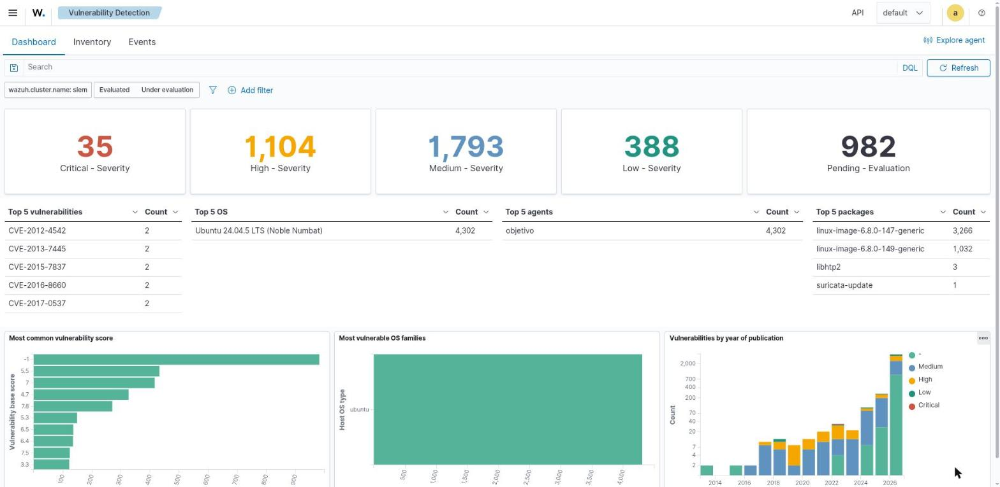
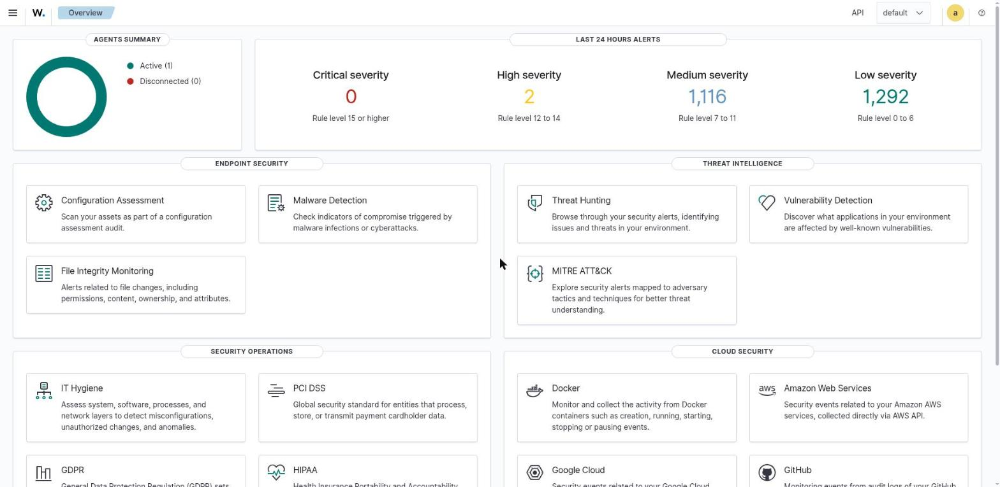
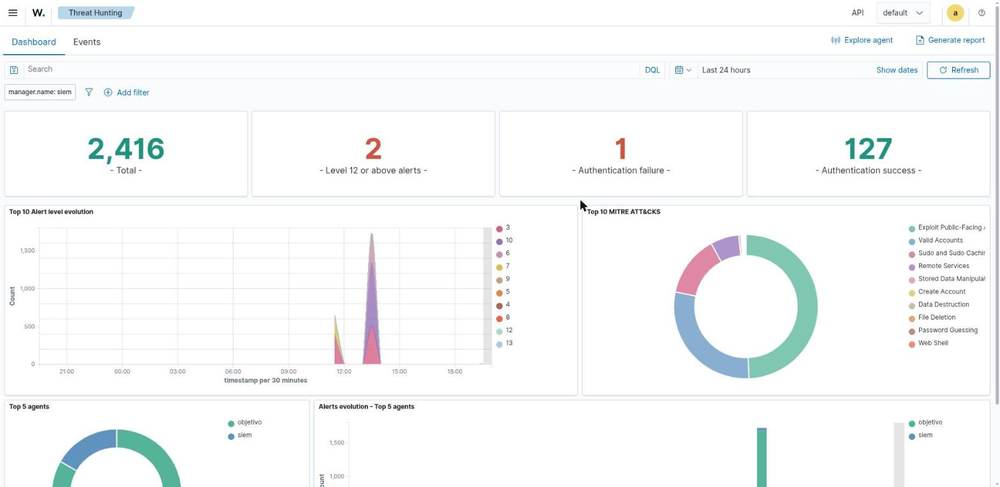
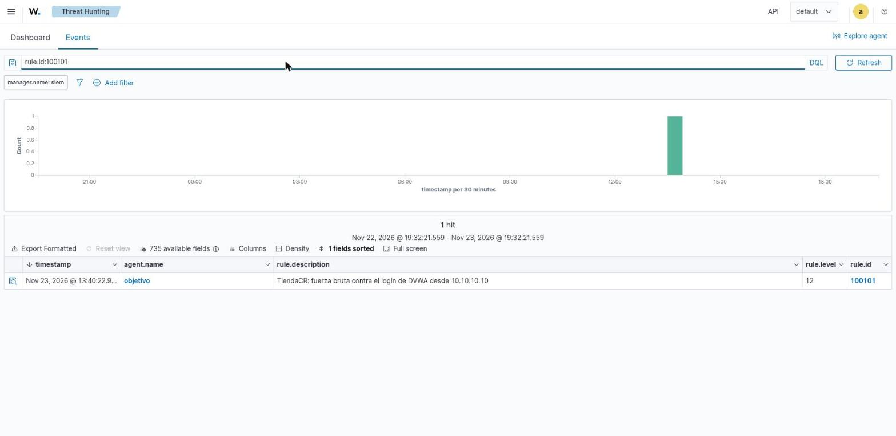
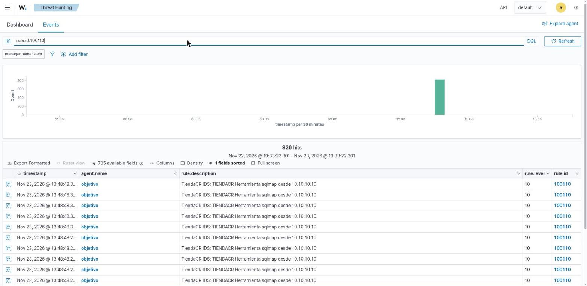
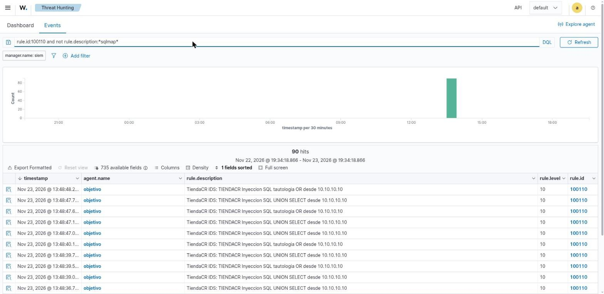
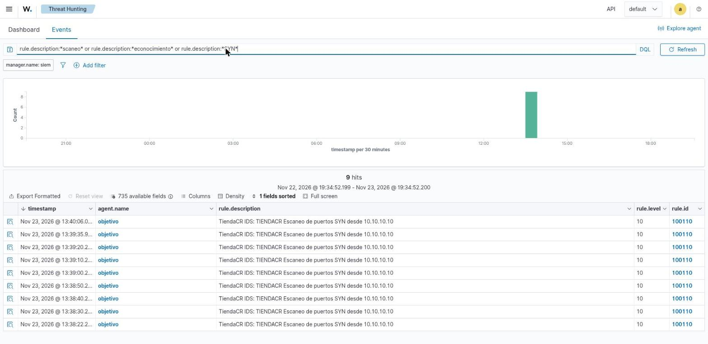
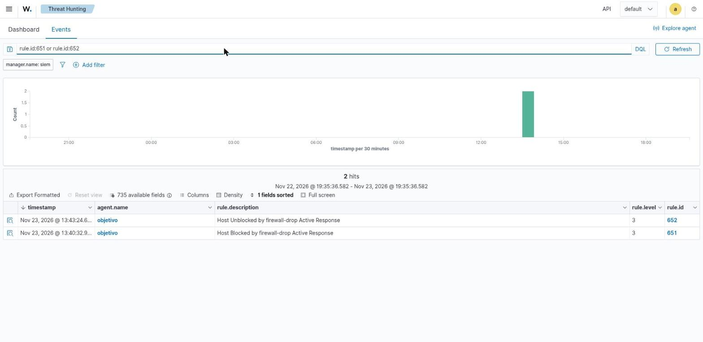

# Mini SOC en la nube — TiendaCR

**Curso:** ITI-922 Seguridad de TI II · **Proyecto 2** (15 %) · Prof. Marcos C.
**Integrantes:** Rodríguez González, Justin · Rojas Morales, Cristian
**Fecha:** 25 de noviembre de 2026
**Repositorio:** https://github.com/JustinRodGon/mini-soc-tiendacr

> **Declaración de uso de IA.** Se utilizó un asistente de IA (Claude) para apoyar la
> redacción del informe, la generación de los scripts de despliegue y de ataque, y la
> depuración de las reglas de detección. Todo el contenido fue revisado y comprendido por
> el equipo; la configuración se ejecutó y verificó en el laboratorio propio. El uso de IA
> no sustituye la comprensión que se evalúa en la defensa oral.

---

## Índice

1. Resumen ejecutivo
2. Introducción y objetivos
3. Fase 1 — Investigación
   - 3.1 Comparativa de herramientas de seguridad en la nube
   - 3.2 Modelo de responsabilidad compartida
   - 3.3 Análisis de riesgos del escenario (NIST SP 800-30)
4. Arquitectura y despliegue (2.1)
5. Control de acceso y de tráfico (2.2)
6. Monitoreo (2.3) y reglas propias (2.5)
7. Ataques controlados y detecciones (2.4)
8. Respuesta automática (2.6)
9. Plan de respuesta a incidentes (2.7)
10. Remediación y reevaluación (2.8)
11. Conclusiones
12. Referencias (APA)
13. Glosario
14. Anexos

---

## Resumen ejecutivo

Se diseñó y operó un centro de operaciones de seguridad (SOC) mínimo para la tienda en línea
ficticia **TiendaCR**. El SOC protege un servidor web vulnerable (DVWA sobre contenedor) con
controles de acceso de denegación por defecto, lo monitorea con un IDS de red (Suricata) y un
HIDS/SIEM (Wazuh), y responde de forma automática a los ataques. Sobre esta plataforma se
ejecutaron cuatro ataques controlados —reconocimiento, fuerza bruta, inyección SQL y subida de
webshell— **todos detectados** por reglas propias, con su evidencia, tiempo de alerta y técnica
MITRE ATT&CK. La respuesta automática bloqueó en el firewall la IP atacante tras superar el umbral
de fallos de autenticación, y el bloqueo se verificó y se liberó solo. Finalmente se remedió la
aplicación y se repitieron los ataques: la inyección SQL pasó de volcar la tabla de usuarios
completa a **no ser explotable**, reduciendo el riesgo residual de Alto a Bajo.

El laboratorio se construyó en local sobre **KVM/libvirt** (equivalente a VirtualBox, justificado
en §4.1), con una red interna aislada 10.10.10.0/24 y el cortafuegos UFW en lugar de un grupo de
seguridad de nube. El proyecto demuestra, de forma medible y reproducible, el ciclo completo de un
SOC: **prevenir** (controles de acceso), **detectar** (IDS + SIEM con reglas propias), **responder**
(bloqueo automático) y **recuperar** (remediación y reevaluación del riesgo).

**Principales resultados.** (1) Cuatro ataques detectados con un tiempo de alerta de segundos.
(2) Diez reglas de detección propias (siete de Suricata y tres de Wazuh), por encima de las tres
exigidas. (3) Una respuesta automática verificada que aísla al atacante sin cortar el tráfico
legítimo del equipo. (4) Una remediación que reduce el riesgo de la inyección SQL de nivel Alto (9)
a Bajo (2) y se comprueba con la misma herramienta de ataque.

---

## Introducción y objetivos

La migración de servicios a la nube traslada parte de la seguridad al proveedor, pero deja en manos
del cliente la protección del sistema operativo, la aplicación, los datos y el acceso. Muchas
organizaciones pequeñas, como la ficticia **TiendaCR**, despliegan un servidor web sin un plan de
monitoreo ni de respuesta: si son atacadas, no se enteran. Este proyecto construye, para esa
empresa, el **centro de operaciones de seguridad (SOC)** que no tiene, y lo pone a prueba con
ataques reales en un entorno controlado.

El trabajo persigue cinco objetivos, alineados con los resultados de aprendizaje de la unidad IV:

1. **Reconocer** vulnerabilidades, amenazas y riesgos de un servidor en la nube y de su red
   (fase 1, análisis de riesgos).
2. **Aplicar** listas de acceso y control de tráfico para reducir la superficie de ataque
   (§5, denegación por defecto con UFW).
3. **Desplegar y configurar** un IDS y un sistema de monitoreo centralizado (§6, Suricata y Wazuh).
4. **Analizar** riesgos con un método formal y proponer un plan de tratamiento, y reevaluar el
   riesgo residual tras aplicar los controles (§3.3 y §10).
5. **Comunicar** los resultados en un informe técnico y una demostración en vivo.

El alcance se limita, por las reglas de ética del curso, a **máquinas creadas y controladas por el
equipo**: tres VM en una red interna aislada, sin exposición a Internet y sin pruebas de denegación
de servicio. El informe sigue el ciclo de un SOC —prevenir, detectar, responder y recuperar— y cada
sección se conecta con la evidencia recogida en el laboratorio.

---

## Fase 1. Investigación

### 1.1 Comparativa de herramientas de seguridad en la nube

La defensa de un servidor en la nube combina, al menos, tres planos: la **red** (quién habla con
quién), el **host** (qué ocurre dentro de la máquina) y la **configuración/identidad** (cómo está
expuesto el servicio). Ninguna herramienta cubre los tres planos por igual, de modo que la
comparativa busca entender qué plano cubre cada una y cómo se combinan. Se analizan cinco
herramientas: un servicio gestionado de un proveedor cloud (**AWS GuardDuty**) y cuatro de código
abierto (**Wazuh**, **Suricata**, **Falco** y **CrowdSec**).

#### Tabla comparativa (criterios mínimos del enunciado)

| Criterio | **AWS GuardDuty** | **Wazuh 4.14** | **Suricata 7** | **Falco** | **CrowdSec** |
|---|---|---|---|---|---|
| **Qué detecta / protege** | Cuenta e identidades, red y cargas de trabajo en AWS (CloudTrail, VPC Flow Logs, DNS, EKS) | Host: registros, integridad de archivos (FIM), detección de vulnerabilidades, SCA; es SIEM + HIDS | Red (NIDS/IPS): tráfico y capa de aplicación | Host/contenedor/Kubernetes en tiempo de ejecución (syscalls) | Red y aplicación; IPS colaborativo basado en comportamiento |
| **Cómo** | Anomalías + inteligencia de amenazas + ML, sin firmas que mantener | Reglas y decodificadores propios; correlación por frecuencia | Firmas (reglas ET/propias) + anomalías de protocolo | Reglas sobre llamadas al sistema | Escenarios de comportamiento + listas de reputación compartidas |
| **Despliegue / recursos** | SaaS, sin agentes ni infraestructura; se activa por consola | Manager + indexer + dashboard (≥ 4 GB RAM) y agente ligero | Un binario en el host/sensor; liviano | DaemonSet / servicio en el host; liviano | Agente + "bouncer"; muy liviano |
| **Costo / licencia** | De pago, por volumen analizado (p. ej. VPC Flow Logs ~US$1.00/GB el primer tramo, con descuentos por volumen); sin costo fijo | Gratis, **GPLv2** | Gratis, **GPL-2.0** | Gratis, **Apache-2.0** (CNCF) | Gratis, motor **MIT**; listas premium opcionales |
| **Respuesta automática** | Sí, vía EventBridge → Lambda/Security Hub | Sí, *active response* (p. ej. `firewall-drop`) | Como IPS en línea (modo inline) | Alertas; respuesta vía herramientas externas | Sí, el *bouncer* bloquea en firewall/proxy |
| **Integración** | Nativa con todo AWS (Security Hub, Detective) | Suricata, OpenSearch, MITRE, VirusTotal, Slack | Wazuh, ELK, Zeek, SIEM vía EVE JSON | Falcosidekick, Prometheus, SIEM | Firewall, Nginx, Cloudflare, listas comunitarias |
| **Limitaciones** | Solo AWS; costo crece con el tráfico; caja negra | Consume RAM; ruido si no se afinan reglas | No ve dentro de TLS sin descifrado; solo red | Solo host/contenedor, no ve la red | Enfocado en reputación; menos FIM/compliance |

#### Análisis por herramienta

**AWS GuardDuty.** Es el modelo *gestionado*: el proveedor analiza de forma continua los registros
que ya genera la cuenta (CloudTrail, VPC Flow Logs, DNS de Route 53) y aplica aprendizaje automático
e inteligencia de amenazas sin que el equipo mantenga firmas ni infraestructura. Su fortaleza es la
cobertura de **identidad y configuración** —detecta llamadas de API sospechosas, llaves filtradas o
instancias comunicándose con dominios maliciosos— que las herramientas de host y red no ven. Su
debilidad para este proyecto es que solo funciona dentro de AWS y cobra por volumen analizado, lo
que lo descarta para un laboratorio local sin costo.

**Wazuh.** Es una plataforma **SIEM + HIDS** de código abierto. El *manager* recibe los eventos de
agentes ligeros instalados en cada servidor y les aplica reglas y decodificadores; el *indexer*
(basado en OpenSearch) almacena y busca, y el *dashboard* visualiza. Para TiendaCR aporta tres
capacidades decisivas: la lectura de los registros de autenticación y web (fuerza bruta), la
**integridad de archivos** en tiempo real (detección del webshell) y la **respuesta automática**.
Su costo es nulo, pero consume memoria (de ahí el dimensionamiento del SIEM a 5 GB).

**Suricata.** Es un **IDS/IPS de red** que inspecciona el tráfico y reconstruye la capa de
aplicación (HTTP, TLS, DNS…). Funciona con firmas —el conjunto Emerging Threats Open trae ~53 500—
y permite escribir reglas propias sencillas. Es el ojo de red del SOC: ve el escaneo de puertos y
las cadenas de inyección en las URL. Su límite es que no ve dentro del tráfico cifrado sin
descifrarlo y que solo observa la red, no lo que ocurre dentro del host.

**Falco** y **CrowdSec** se evaluaron pero no se usaron. Falco observa las *llamadas al sistema*
del host y los contenedores (excelente para detectar que un proceso web lanza una shell), pero no
ve la red, que es central en este escenario. CrowdSec es un IPS colaborativo orientado a
**reputación de IP** y bloqueo; es muy liviano, pero aporta menos en integridad de archivos y
cumplimiento, que el proyecto sí exige.

#### Justificación de la elección

Para TiendaCR se eligieron **Wazuh** como SIEM/HIDS central y **Suricata** como IDS de red. Tres
razones: (1) **cobertura complementaria** —Suricata ve la red (ataques 1 y 3) y Wazuh ve el host
(ataques 2 y 4), de modo que juntos cubren los cuatro ataques del escenario—; (2) **costo y
reproducibilidad** —ambos son libres, sin costo y se despliegan en un laboratorio local, lo que
cumple el requisito de que el repositorio permita reproducir el entorno—; y (3) **reglas propias y
respuesta automática** —los dos permiten reglas personalizadas sencillas y Wazuh integra la
respuesta `firewall-drop` exigida en 2.6. GuardDuty se incluye como referencia del modelo
gestionado, útil para discutir el reparto de responsabilidad, pero su dependencia de AWS y su costo
por volumen lo hacen inviable aquí.

### 1.2 Modelo de responsabilidad compartida

El modelo de responsabilidad compartida define qué asegura el proveedor de nube y qué asegura el
cliente, y varía según el tipo de servicio (IaaS, PaaS o SaaS). Este proyecto usa un servidor de
tipo **máquina virtual (IaaS)**, el modelo en el que **más responsabilidad recae sobre el cliente**.
Se toma AWS como proveedor de referencia; en el laboratorio local el papel del "proveedor" lo
cumple el administrador del host KVM.

| Capa | Responsable | En este proyecto |
|---|---|---|
| Instalaciones físicas, hardware, red física | **Proveedor** / admin. del host | KVM sobre la laptop |
| Hipervisor y aislamiento entre VM | **Proveedor** / admin. del host | libvirt/QEMU-KVM |
| Sistema operativo invitado y sus parches | **Cliente** | Ubuntu 24.04 actualizado |
| Red virtual: grupos de seguridad / firewall | **Cliente** | UFW deny por defecto |
| Aplicación (DVWA), base de datos y dependencias | **Cliente** | Contenedores |
| Control de acceso, llaves SSH, identidades | **Cliente** | Solo llave, sin root |
| Monitoreo, registros, detección y respuesta | **Cliente** | Suricata + Wazuh |
| Cifrado de datos y gestión de llaves | **Cliente** (el servicio lo ofrece el proveedor) | Hashes de contraseñas |

La lección central (Dotson, 2019; Guijarro Olivares et al., 2019) es que en IaaS **casi todo lo que está por encima del hipervisor
es responsabilidad del cliente**. El proveedor garantiza la seguridad *de* la nube —centros de
datos, hardware, hipervisor—; el cliente garantiza la seguridad *en* la nube —SO, red virtual,
aplicación, datos, accesos y monitoreo—. Un ejemplo concreto: si un atacante aprovecha la inyección
SQL de TiendaCR y roba la base de datos, la falla es **del cliente**, no del proveedor, porque la
aplicación y su configuración están en la capa que el cliente administra. Este proyecto cubre
precisamente esa mitad del cliente: endurecer el SO, restringir el acceso, monitorear y responder.

### 1.3 Análisis de riesgos del escenario (NIST SP 800-30)

Se aplica el método de **NIST SP 800-30 Rev. 1**, simplificado. El proceso tiene cuatro pasos:
(1) **preparar** la evaluación definiendo el alcance —la arquitectura de tres máquinas—; (2)
**realizar** la evaluación, que a su vez identifica activos, fuentes de amenaza, vulnerabilidades,
y determina la probabilidad y el impacto para derivar el nivel de riesgo; (3) **comunicar** los
resultados —esta sección y la matriz—; y (4) **mantener** la evaluación, que aquí corresponde a la
reevaluación del riesgo residual tras aplicar los controles (§8). El riesgo se entiende como la
combinación de la **probabilidad** de que una amenaza explote una vulnerabilidad y el **impacto**
resultante sobre la confidencialidad, la integridad o la disponibilidad.

#### 1.3.1 Inventario de activos y su valor

Se valora cada activo según su necesidad de **confidencialidad (C)**, **integridad (I)** y
**disponibilidad (D)**, y se asigna un valor global.

| Activo | C | I | D | Valor | Justificación |
|---|---|---|---|---|---|
| A1. Servidor objetivo (SO + Docker) | Alta | Alta | Alta | Alto | Aloja la aplicación y el IDS; su caída ciega al SOC |
| A2. Aplicación web DVWA (TiendaCR) | Alta | Alta | Media | Alto | Cara pública; es la superficie de ataque principal |
| A3. Base de datos (usuarios, hashes) | Alta | Alta | Media | Alto | Contiene credenciales; su fuga es el peor caso |
| A4. Servidor SIEM (Wazuh + alertas) | Alta | Alta | Alta | Crítico | Es el cerebro del SOC; sin él no hay detección |
| A5. Llaves SSH y credenciales | Alta | Alta | Baja | Crítico | Su compromiso da acceso administrativo total |
| A6. Red interna del laboratorio | Media | Media | Alta | Medio | Canal entre máquinas; su corte detiene la operación |

#### 1.3.2 Amenazas y vulnerabilidades por activo

| Activo | Fuente de amenaza | Vulnerabilidad asociada |
|---|---|---|
| A2 | Atacante externo / automatizado | Entradas sin validar → inyección SQL (CWE-89), XSS (CWE-79) |
| A2 | Atacante autenticado | Subida de archivos sin restricción (CWE-434) |
| A1/A5 | Atacante externo | Credenciales débiles/por defecto, servicios expuestos |
| A1 | Atacante / malware | Software sin parches en el SO o el contenedor |
| A3 | Atacante tras una fuga | Hashes débiles (MD5) susceptibles de descifrado offline |
| A4 | Atacante o error de diseño | SIEM subdimensionado o saturado; respuesta mal ajustada |
| A6 | Reconocimiento previo | Visibilidad de puertos y servicios por escaneo |

#### 1.3.3 Matriz de riesgos (probabilidad × impacto)

Escala: Baja(1) / Media(2) / Alta(3). Nivel = P×I → 1–2 Bajo, 3–4 Medio, 6–9 Alto.

| # | Activo | Amenaza / vulnerabilidad | P | I | Nivel |
|---|---|---|---|---|---|
| R1 | A2 | Inyección SQL (CWE-89) → fuga de la BD | 3 | 3 | **Alto (9)** |
| R2 | A2 | Subida de webshell (CWE-434) → ejecución remota | 3 | 3 | **Alto (9)** |
| R3 | A1/A5 | Fuerza bruta a SSH/login (CWE-307) | 3 | 3 | **Alto (9)** |
| R4 | A2 | XSS reflejado/almacenado (CWE-79) | 2 | 2 | Medio (4) |
| R5 | A1 | Puertos/servicios expuestos a Internet | 2 | 3 | **Alto (6)** |
| R6 | A1 | Software sin parches (SO/contenedor) | 2 | 3 | **Alto (6)** |
| R7 | A5 | Credenciales por defecto (`admin/password`) | 3 | 2 | **Alto (6)** |
| R8 | A3 | Exfiltración de hashes y descifrado offline | 2 | 3 | **Alto (6)** |
| R9 | A4 | Caída/saturación del SIEM → ceguera | 2 | 3 | **Alto (6)** |
| R10 | A4 | Respuesta automática bloquea tráfico legítimo | 2 | 2 | Medio (4) |
| R11 | A6 | Reconocimiento/escaneo previo al ataque | 3 | 1 | Medio (3) |
| R12 | A1 | Path traversal / lectura de archivos (CWE-22) | 2 | 2 | Medio (4) |

De los doce riesgos, **siete son de nivel Alto**, y los tres más altos (R1, R2, R3) corresponden
exactamente a los ataques que se ejecutan y detectan en la fase 2, lo que conecta el análisis
teórico con la demostración práctica.

#### 1.3.4 Puntajes CVSS v3.1 de vulnerabilidades reales usadas

Se calcula el puntaje **CVSS v3.1** de las tres vulnerabilidades explotadas en el proyecto. El
vector describe cómo se explota (métricas de explotabilidad) y qué daño causa (métricas de impacto).

**V1 — Inyección SQL (ataque 3).** CWE-89 / OWASP A03:2021-Injection.
Vector `AV:N/AC:L/PR:L/UI:N/S:U/C:H/I:H/A:N` → **Base 8.1 (Alta)**.
- *Attack Vector: Network* — se explota por HTTP desde la red.
- *Attack Complexity: Low* — una sola petición con `' OR '1'='1` basta.
- *Privileges Required: Low* — en DVWA la página requiere sesión iniciada.
- *User Interaction: None*, *Scope: Unchanged*.
- *Confidentiality: High / Integrity: High* — se lee y se podría alterar toda la base de datos;
  *Availability: None*.

**V2 — Subida de archivo sin restricción → webshell (ataque 4).** CWE-434 / OWASP A04:2021.
Vector `AV:N/AC:L/PR:L/UI:N/S:U/C:H/I:H/A:H` → **Base 8.8 (Alta)**.
- Igual explotabilidad que V1, pero el impacto es total: una webshell da **ejecución de comandos**,
  comprometiendo confidencialidad, integridad y disponibilidad del servidor.

**V3 — Credenciales débiles + fuerza bruta (ataque 2).** CWE-307/CWE-521 / OWASP A07:2021.
Vector `AV:N/AC:L/PR:N/UI:N/S:U/C:H/I:H/A:N` → **Base 9.1 (Crítica)**.
- *Privileges Required: None* — no se necesita sesión previa para intentar adivinar la contraseña,
  lo que eleva la explotabilidad respecto de V1 y V2 y lleva el puntaje a Crítico.

#### 1.3.5 Plan de tratamiento

Para cada riesgo se decide **mitigar, transferir, aceptar o evitar**, con un control y un
responsable.

| # | Decisión | Control propuesto | Responsable |
|---|---|---|---|
| R1 | Mitigar | Consultas parametrizadas (nivel `impossible`) + reglas IDS 1000004/5/6 | Dev / SOC |
| R2 | Mitigar | Validar tipo de archivo, carpeta sin ejecución; FIM 100120 | Dev / SOC |
| R3 | Mitigar | SSH solo con llave; respuesta automática `firewall-drop` | SOC |
| R4 | Mitigar | Codificación de salida; cabeceras CSP | Dev |
| R5 | Mitigar | UFW deny por defecto; solo IP del equipo | SOC |
| R6 | Mitigar | `apt upgrade`, imágenes de contenedor al día | Sysadmin |
| R7 | Mitigar | Cambiar credenciales por defecto; política de contraseñas | Dev |
| R8 | Transferir/Mitigar | Hash fuerte (bcrypt), no MD5; cifrado en reposo | Dev |
| R9 | Mitigar | Dimensionar RAM del SIEM; alertas de disponibilidad | SOC |
| R10 | Aceptar | Lista blanca de IP del equipo + timeout corto (180 s) | SOC |
| R11 | Aceptar | Es inevitable; se monitorea (reglas 1000001/2) | SOC |
| R12 | Mitigar | Normalizar rutas; `open_basedir` | Dev |

La **reevaluación** del riesgo residual, tras aplicar los controles, está en §8.

---

## Fase 2. Implementación, ataque, detección y respuesta

### 4. Arquitectura y despliegue (2.1)

#### 4.1 Decisiones de entorno

El laboratorio se montó en **KVM/libvirt**, no en VirtualBox, porque el equipo ya tenía KVM
instalado y en Linux ambos hipervisores entran en conflicto por el módulo de virtualización. Las
reglas del escenario (red interna aislada, denegación por defecto con el firewall de cada máquina,
IP fijas por MAC) son idénticas a las de VirtualBox, de modo que el cambio de hipervisor no afecta
los resultados. Además, la imagen *cloud* de Kali reiniciaba en bucle al cargar su kernel en este
hardware (Intel i5-11400H); por eso la máquina atacante ejecuta **Kali en contenedor** sobre una
base Ubuntu. El tráfico de ataque sale igual desde la IP de la atacante (10.10.10.10), por lo que
para el IDS y el SIEM el origen es transparente.

#### 4.2 Diagrama

```
  Laptop del equipo (host KVM)  10.10.10.1
        │  (SSH admin, panel Wazuh)
        │
  ┌─────┴───────── Red interna soc-net (10.10.10.0/24, NAT) ─────────────┐
  │                          │                           │
  ▼                          ▼                           ▼
 Kali (atacante)       Servidor objetivo            Servidor SIEM
 10.10.10.10           10.10.10.20                  10.10.10.30
 nmap, hydra,          Ubuntu 24.04:                Ubuntu 24.04:
 sqlmap                · DVWA en Docker             · Wazuh manager
 (contenedor Kali)     · Suricata (IDS)             · Wazuh indexer
                       · Agente Wazuh               · Wazuh dashboard
                       · UFW (deny por defecto)     · UFW (deny por defecto)
                          │  alertas (1514/1515)       ▲
                          └────────────────────────────┘
                       Respuesta automática: el manager ordena al agente
                       bloquear la IP atacante en el firewall (firewall-drop).
```

#### 4.3 Componentes

- **Servidor objetivo (10.10.10.20):** Ubuntu Server 24.04 LTS. DVWA corre en un contenedor
  (`ghcr.io/digininja/dvwa`) con su base de datos MariaDB en otro contenedor. El contenedor usa la
  red del host para que las reglas de UFW y la respuesta automática lo protejan (un puerto publicado
  por Docker se saltaría UFW). Los registros de Apache se exponen al agente en `/var/log/dvwa` y la
  carpeta de subidas (`/srv/dvwa/uploads`) se vigila con integridad de archivos.
- **Servidor SIEM (10.10.10.30):** Wazuh 4.14.10 "todo en uno" (manager + indexer + dashboard),
  dimensionado a 5 GB de RAM según la guía de inicio rápido.
- **Atacante (10.10.10.10):** base Ubuntu con el contenedor oficial `kalilinux/kali-rolling` y sus
  herramientas (nmap, hydra, sqlmap). El comando `kali` abre una terminal de Kali en la red del host.
- **Aprovisionamiento:** las VM se crean con **cloud-init**, que configura el usuario `soc`, instala
  solo la llave pública y endurece `sshd` (sin contraseña, sin root). Toda la instalación es
  automática vía `infra/crear-vms.sh` y `infra/provisionar.sh`.

### 5. Control de acceso y de tráfico (2.2)

El escenario se protege **antes** de monitorearlo, aplicando dos principios de la unidad I:
**denegación por defecto** (lo que no está permitido, está prohibido) y **menor privilegio** (cada
máquina solo puede hacer lo estrictamente necesario). Se implementa con UFW en cada máquina, con
política de denegación en **ambos sentidos** (entrada y salida).

Todo acceso administrativo y a la aplicación está restringido a las IP del equipo —10.10.10.1 (la
laptop) y 10.10.10.10 (la atacante)— **nunca a 0.0.0.0/0**. El acceso SSH es **solo con llave**, sin
contraseña y sin root directo; `cloud-init` escribe un archivo de configuración que fija
`PasswordAuthentication no`, `PermitRootLogin no` y `MaxAuthTries 3`.

#### Tabla de reglas del servidor objetivo

| Regla | Sentido | Origen → Puerto | Justificación | Riesgo que mitiga | Principio |
|---|---|---|---|---|---|
| R1 | in | laptop → 22/tcp | Administración | Acceso no autorizado (R3) | Menor privilegio |
| R2 | in | Kali → 22/tcp | Prueba de fuerza bruta | — (controlado) | Denegación por defecto |
| R3 | in | laptop → 80/tcp | Uso de la tienda | Exposición de la app (R5) | Menor privilegio |
| R4 | in | Kali → 80/tcp | Ataques controlados | — (controlado) | Denegación por defecto |
| R5 | out | → SIEM 1514/1515 | Envío de alertas | Pérdida de visibilidad (R9) | Necesidad de saber |
| R6 | out | → laptop 53 | DNS del laboratorio | — | Menor privilegio |
| R7 | out | → 80/443 | Actualizaciones apt/Docker | Software sin parches (R6) | Menor privilegio |
| R8 | out | → 123/udp | Hora NTP (marcas de tiempo) | Alertas con hora incorrecta | Integridad |
| R9 | out | → BD en Docker | DVWA ↔ MariaDB | — | Menor privilegio |

Toda otra entrada y salida queda **denegada**. El SIEM aplica una tabla análoga: solo acepta el
panel (443) y SSH desde la laptop, y los eventos del agente (1514/1515) desde el objetivo; su regla
de salida es permisiva solo para poder instalarse y actualizarse. Esta configuración reduce la
superficie de ataque a dos puertos por máquina y solo desde dos orígenes conocidos.

### 6. Monitoreo (2.3) y reglas propias (2.5)

El monitoreo combina un **IDS de red** (Suricata, que ve el tráfico) y un **HIDS/SIEM** (Wazuh, que
ve el host y correlaciona). El enunciado pedía 2 reglas propias de Suricata y 1 de Wazuh; se
entregaron **7 y 4** respectivamente, cada una ligada a un ataque de la tabla.

#### 6.1 Suricata — reglas propias (`objetivo/suricata/tiendacr.rules`)

| SID | Qué detecta | Técnica |
|---|---|---|
| 1000001 | 25+ paquetes SYN desde una IP en 10 s (escaneo `nmap -sS`) | T1046 |
| 1000002 | User-Agent "Nmap Scripting Engine" en HTTP | T1595 |
| 1000003 | 15+ peticiones a `/vulnerabilities/brute/` con `password=` en 30 s | T1110.001 |
| 1000004 | `UNION … SELECT` en la URL | T1190 |
| 1000005 | Comilla/`OR` tautológico (`' OR '1'='1`) por expresión regular | T1190 |
| 1000006 | User-Agent de `sqlmap` | T1190 |
| 1000007 | `<?php` en el cuerpo de una subida a `/vulnerabilities/upload/` | T1505.003 |

Suricata usa, además, el conjunto **Emerging Threats Open** (~53 500 firmas), de modo que un mismo
ataque suele disparar tanto una firma pública como la regla propia, lo que valida la detección.

#### 6.2 Wazuh — reglas propias (`siem/local_rules.xml`)

- **100100 (nivel 3):** registra cada intento de inicio de sesión en DVWA (decodificador
  `web-accesslog`, URL `/vulnerabilities/brute/`, con `password=`). Es informativa.
- **100101 (nivel 12):** si la regla 100100 se dispara **10 veces en 30 s desde la misma IP**, la
  correlación por frecuencia la eleva a "fuerza bruta". Esta regla es la que **dispara la respuesta
  automática**.
- **100110 (nivel 10):** eleva a nivel medio cualquier alerta de Suricata cuya firma empiece por
  `TIENDACR` (integración IDS → SIEM).
- **100120 (nivel 13):** si aparece un archivo `.php`/`.phtml`/`.phar` **nuevo** en la carpeta de
  subidas (evento de integridad de archivos), lo marca como posible webshell.

El agente del objetivo envía al manager los registros web (`access.log`, `error.log`), las alertas
de Suricata (`eve.json`) y los eventos de integridad de archivos en tiempo real sobre
`/srv/dvwa/uploads`, `/opt/tiendacr` y `/etc/ssh`. Además lee por defecto el diario del sistema
(journald), de donde salen los eventos de **autenticación**: inicios de sesión SSH (regla 5715),
sesiones PAM (5501/5502) y uso de `sudo` (5402).

#### 6.3 Detección de vulnerabilidades

El módulo *Vulnerability Detection* de Wazuh está activo en el manager
(`<vulnerability-detection><enabled>yes</enabled>`) y cruza el inventario de paquetes que envía el
agente (*syscollector*) con los avisos de seguridad de Canonical y de la NVD, actualizados cada 60
minutos. El 25/11/2026 reportó **4302 vulnerabilidades** en el servidor objetivo:

| Severidad | Crítica | Alta | Media | Baja | Pendiente de evaluar |
|---|---|---|---|---|---|
| Cantidad | 35 | 1104 | 1793 | 388 | 982 |

Casi todas (4298 de 4302, incluidas las 35 críticas) están en los dos paquetes de kernel instalados
(`linux-image-6.8.0-147` y `-149`), por ejemplo CVE-2026-74612 (CVSS 10.0); las otras cuatro son de
`libhtp2` y `suricata-update`. El tratamiento es aplicar las actualizaciones (`apt upgrade`),
reiniciar con el kernel nuevo y retirar el anterior, que es el que acumula más avisos (3266); el riesgo R6 (software sin parches) de la
matriz se apoya en esta evidencia. La cifra total es alta porque el detector cuenta cada CVE por
paquete y versión, incluidos los que Ubuntu aún no ha corregido, así que debe leerse como un
inventario para priorizar, no como 4302 fallas explotables.



### 7. Ataques controlados y detecciones (2.4)

Para cada ataque se documenta el comando, la regla que lo detectó, el tiempo hasta la alerta y la
técnica MITRE ATT&CK. Todos se ejecutaron desde la máquina atacante contra 10.10.10.20.

| # | Ataque | Herramienta / comando | Regla que detectó | Tiempo | MITRE |
|---|---|---|---|---|---|
| 1 | Reconocimiento | `nmap -sS -sV -p- 10.10.10.20` | Suricata 1000001 + 1000002 + ET SCAN | 3,5 s | T1046, T1595 |
| 2 | Fuerza bruta | 20 intentos a `/vulnerabilities/brute/` | Wazuh 100100 → 100101 (nivel 12) + Suricata 1000003 | ~9 s | T1110.001 |
| 3 | Inyección SQL | manual + `sqlmap --dump` | Wazuh 31171 + Suricata 1000004/1000005/1000006 | ~1 s | T1190 |
| 4 | Webshell | `.php` subido a `/vulnerabilities/upload/` | Wazuh FIM 100120 (tiempo real) + Suricata 1000007 | < 1 s | T1505.003 |

El tiempo es el que pasa desde que el script lanza el primer paquete o petición maliciosa (hora de
la máquina atacante) hasta la marca de tiempo de la primera alerta en el manager de Wazuh. Las tres
máquinas sincronizan su reloj por NTP. Medición del 25/11/2026, con los ataques en el orden de la
demostración. Un hallazgo de la medición: el escaneo completo (`nmap -p-`) genera cientos de miles
de eventos `flow` en `eve.json` y llena la cola del agente (alertas 202/203 de Wazuh); mientras se
vacía, las alertas llegan con unos 10 s de retraso, como le ocurrió a la fuerza bruta. Con la cola
libre, la SQLi y la webshell se alertan en alrededor de un segundo.

#### 7.1 Ataque 1 — Reconocimiento

`nmap -sS -sV -p-` envía paquetes SYN a los 65 535 puertos para descubrir cuáles están abiertos y
qué servicio corre en ellos. Encontró el 22 (OpenSSH 9.6) y el 80 (Apache 2.4). Suricata contó la
ráfaga de SYN y disparó la regla propia **1000001**; además, el escaneo con scripts (`-sC`) viaja
con el User-Agent "Nmap Scripting Engine", que disparó la **1000002** y la firma ET `2009358`. Es el
primer paso de un atacante (MITRE *Active Scanning*, T1595; *Network Service Discovery*, T1046) y el
SOC lo ve de inmediato.

#### 7.2 Ataque 2 — Fuerza bruta contra el login

El script envió 20 intentos de contraseña contra el formulario `/vulnerabilities/brute/`. Suricata
superó su umbral y disparó la **1000003**. En Wazuh, cada intento generó la regla **100100** y, al
décimo intento dentro de la ventana de 30 s, la correlación disparó la **100101** (nivel 12), que
**activó la respuesta automática** (§8 siguiente). Línea de registro de muestra:

```
10.10.10.10 - - [23/Nov/2026:19:40:13] "GET /vulnerabilities/brute/?username=admin&password=admin&Login=Login" 200
```

Corresponde a MITRE *Brute Force: Password Guessing* (T1110.001).

#### 7.3 Ataque 3 — Inyección SQL

Se probaron dos vías. La manual inyectó una tautología (`1' OR '1'='1`) y un `UNION SELECT
user,password FROM users`, que dispararon las reglas **1000005** y **1000004**. Luego `sqlmap`
automatizó el ataque y **volcó la tabla `dvwa.users` completa**, incluidos los hashes MD5
(`5f4dcc3b…`, que es `password`); su User-Agent disparó la **1000006**. La fuga de toda la tabla de
credenciales confirma el impacto *Confidentiality: High* del CVSS. Corresponde a MITRE *Exploit
Public-Facing Application* (T1190).

#### 7.4 Ataque 4 — Subida de webshell

Se subió un archivo PHP (`tienda_shell.php`) por el formulario de carga de DVWA, haciéndolo pasar
por imagen. El archivo quedó en la carpeta de subidas, que está montada en el host y vigilada por la
integridad de archivos de Wazuh **en tiempo real**: la aparición del `.php` disparó la regla
**100120** en segundos. Al invocar la webshell (`?c=id`) devolvió `uid=33(www-data)`, probando que
se logró **ejecución de comandos** en el servidor. Corresponde a MITRE *Server Software Component:
Web Shell* (T1505.003). Este ataque ilustra el valor de la defensa en capas: el IDS de red ve poco
de un archivo ya subido, pero el HIDS lo detecta por el cambio en el sistema de archivos.

El detalle con conteos por regla está en el anexo `docs/evidencias.md`.

### 8. Respuesta automática (2.6)

- **Disparador:** regla Wazuh **100101** (10 intentos de login en 30 s desde la misma IP, nivel 12).
- **Acción:** el manager ordena al agente del objetivo ejecutar el comando `firewall-drop`, que
  inserta `iptables … DROP 10.10.10.10` durante **180 s**.
- **Verificación:** durante el bloqueo, la atacante recibe HTTP 000 (sin respuesta); el bloqueo se
  liberó solo al expirar el timeout (19:40:22 → 19:43:25 en la prueba real).
- **Flujo completo:** intento de login → regla 100100 ×10 → regla 100101 (nivel 12) → el manager
  evalúa la lista blanca → envía la orden al agente → el agente ejecuta `firewall-drop` → iptables
  bloquea la IP → tras 180 s, el agente retira la regla.

**Riesgo (R10).** Una respuesta automática puede bloquear tráfico legítimo si un atacante falsea la
IP de un usuario real (una denegación de servicio inducida por el propio SOC). Se mitiga con **lista
blanca** de la laptop (10.10.10.1) y el SIEM (10.10.10.30) —que nunca se bloquean, de modo que el
equipo no se puede autobloquear— y un **timeout corto** que evita cortes permanentes. En producción
se complementaría con CAPTCHA y bloqueo por cuenta, no solo por IP, para no castigar a todos los
usuarios detrás de una misma IP pública (por ejemplo, de una empresa o una red móvil).

### 9. Plan de respuesta a incidentes (2.7)

Aplicado al **ataque 2 (fuerza bruta contra el login)**, siguiendo las fases de **NIST SP 800-61
Rev. 2**. Roles: _Analista SOC_ (monitorea y contiene) y _Administrador_ (erradica y recupera).

| Fase | Acciones | Tiempo objetivo |
|---|---|---|
| **Preparación** | SOC desplegado, reglas y respuesta automática activas, respaldos y llaves documentados | Previo |
| **Detección y análisis** | Alerta 100101 en el panel; el analista confirma IP origen, cuenta objetivo y número de intentos | ≤ 1 min |
| **Contención** | La respuesta automática ya bloqueó la IP (180 s); el analista extiende el bloqueo si el ataque persiste | ≤ 2 min |
| **Erradicación** | Cambiar credenciales por defecto, forzar contraseñas fuertes, revisar en los registros si hubo algún acceso exitoso | ≤ 30 min |
| **Recuperación** | Confirmar que no hubo acceso válido; levantar el bloqueo; reanudar la operación bajo monitoreo reforzado | ≤ 1 h |
| **Lecciones aprendidas** | Documentar el incidente; añadir MFA/CAPTCHA; ajustar umbrales si hubo falsos positivos | ≤ 1 semana |

El objetivo de tiempos agresivos en las primeras fases se cumple gracias a que la **contención es
automática**: el bloqueo ocurre sin intervención humana, y el analista solo valida y decide si lo
extiende, lo que reduce el tiempo de exposición de minutos a segundos.

### 10. Remediación y reevaluación (2.8)

Se corrigió la aplicación llevando DVWA al nivel **`impossible`**, que usa **consultas preparadas
(parametrizadas)**, tokens anti-CSRF y validación de entrada. La diferencia de fondo es cómo se
construye la consulta SQL:

```php
// Nivel 'low' (vulnerable): la entrada del usuario se concatena directamente
$query = "SELECT first_name, last_name FROM users WHERE user_id = '$id';";

// Nivel 'impossible' (seguro): la entrada viaja como parámetro, nunca como código
$stmt = $db->prepare('SELECT first_name, last_name FROM users WHERE user_id = (:id) LIMIT 1;');
$stmt->bindParam(':id', $id, PDO::PARAM_INT);
```

Con la consulta parametrizada, el motor trata `$id` siempre como un **dato**, nunca como parte de la
instrucción SQL, de modo que un `' OR '1'='1` deja de ser ejecutable. Se repitieron los ataques 2 y
3 y se comparó:

| Ataque | Antes (nivel `low`) | Después (nivel `impossible`) |
|---|---|---|
| 3. Inyección SQL | `sqlmap` volcó la tabla `users` con sus hashes | `all tested parameters do not appear to be injectable` — **falla** |
| 2. Fuerza bruta | el formulario vulnerable responde | consultas preparadas + token; sin acceso, y la IP queda bloqueada |

**Reevaluación del riesgo residual** (paso 4 de NIST 800-30, "mantener la evaluación"):

| # | Nivel inicial | Control aplicado | Riesgo residual |
|---|---|---|---|
| R1 (SQLi) | Alto (9) | Consultas parametrizadas + IDS | **Bajo (2)** |
| R2 (Webshell) | Alto (9) | Validación de subida + FIM | **Medio (4)** |
| R3 (Fuerza bruta) | Alto (9) | SSH con llave + respuesta automática | **Bajo (2)** |
| R5 (Exposición) | Alto (6) | UFW deny por defecto | **Bajo (2)** |
| R7 (Credenciales) | Alto (6) | Cambio de credenciales (pendiente de política) | **Medio (4)** |

El riesgo residual de R2 y R7 queda en Medio porque dependen además de controles organizativos
(política de contraseñas, revisión de subidas) que exceden la configuración técnica.

---

## 11. Conclusiones

1. Un SOC mínimo pero completo —controles de acceso, IDS de red, HIDS/SIEM y respuesta automática—
   se puede construir con herramientas libres y detectar los cuatro ataques del escenario con
   evidencia medible, cumpliendo el objetivo del proyecto sin costo de nube.
2. La **defensa en capas** funcionó y se demostró: cuando una capa no vería bien el ataque (el IDS
   de red ante un webshell ya subido), otra sí lo hace (la integridad de archivos del HIDS). Ninguna
   herramienta basta por sí sola; su combinación es lo que da cobertura.
3. La **remediación es verificable**: la misma prueba que antes volcaba la base de datos, después no
   encuentra inyección. Medir *antes y después* con la misma herramienta es lo que convierte una
   corrección en evidencia defendible, y es la diferencia entre "creemos que está arreglado" y
   "demostramos que lo está".
4. La **respuesta automática** es potente pero peligrosa: sin lista blanca y sin timeouts, el propio
   SOC puede causar una denegación de servicio. Un buen diseño asume y acota ese riesgo en lugar de
   ignorarlo.
5. El trabajo confirma el **modelo de responsabilidad compartida**: todas las fallas explotadas
   vivían en la capa del cliente (aplicación, configuración, credenciales), que es exactamente la
   mitad que un proveedor de nube no cubre y que un SOC debe atender.

---

## 12. Referencias (APA)

- Dotson, C. (2019). *Practical cloud security: A guide for secure design and deployment*. O'Reilly Media.
- Guijarro Olivares, J., Caparrós Ramírez, J. y Cubero Luque, L. (2019). *DevOps y seguridad cloud*. Editorial UOC.
- Wazuh Inc. (2026). *Wazuh documentation (v4.14)*. https://documentation.wazuh.com/
- Open Information Security Foundation. (2026). *Suricata user guide (v7)*. https://docs.suricata.io/
- National Institute of Standards and Technology. (2012). *Guide for conducting risk assessments (NIST SP 800-30 Rev. 1)*. https://doi.org/10.6028/NIST.SP.800-30r1
- National Institute of Standards and Technology. (2012). *Computer security incident handling guide (NIST SP 800-61 Rev. 2)*. https://doi.org/10.6028/NIST.SP.800-61r2
- MITRE. (2026). *MITRE ATT&CK Matrix for Enterprise*. https://attack.mitre.org/
- FIRST. (2019). *Common Vulnerability Scoring System v3.1: Specification document*. https://www.first.org/cvss/
- OWASP Foundation. (2021). *OWASP Top 10:2021*. https://owasp.org/Top10/

---

## 13. Glosario

| Término | Definición |
|---|---|
| **SOC** | Centro de Operaciones de Seguridad: equipo y herramientas que monitorean y responden a incidentes |
| **IDS / IPS** | Sistema de detección / prevención de intrusos (el IPS además bloquea) |
| **HIDS** | IDS basado en host (vigila el interior de la máquina) |
| **SIEM** | Gestión de información y eventos de seguridad: centraliza registros y correlaciona |
| **FIM** | Monitoreo de integridad de archivos |
| **CVSS** | Sistema común de puntuación de vulnerabilidades (0–10) |
| **CWE / CVE** | Catálogo de tipos de debilidad / identificador de vulnerabilidad concreta |
| **Webshell** | Script subido a un servidor que permite ejecutar comandos de forma remota |
| **Denegación por defecto** | Política que prohíbe todo salvo lo explícitamente permitido |

---

## Anexos

- **Anexo A.** Repositorio con el README reproducible, scripts de infraestructura y ataque, reglas
  propias y archivos de configuración.
- **Anexo B.** `docs/evidencias.md`: tabla de detecciones con conteos por regla.
- **Anexo C.** Capturas del panel de Wazuh (dashboard, alertas por ataque, bloqueo automático),
  tomadas en `https://10.10.10.30` sobre las ejecuciones reales del 23/11/2026.

### Anexo C — Evidencia visual del panel Wazuh

**C.1 Resumen del SOC.** Agente del objetivo activo y alertas de las últimas 24 h clasificadas por
severidad (2 de nivel alto = la regla propia 100101 de fuerza bruta).



**C.2 Threat Hunting — Top 10 MITRE ATT&CK.** Las técnicas observadas coinciden con los ataques
realizados: Exploit Public-Facing Application (T1190), Password Guessing (T1110), Web Shell
(T1505.003) y Remote Services.



**C.3 Fuerza bruta.** Regla propia `100101` (nivel 12): *"TiendaCR: fuerza bruta contra el login de
DVWA desde 10.10.10.10"*, disparada tras superar el umbral de intentos fallidos.



**C.4 Webshell (FIM en tiempo real).** Regla propia `100120` (nivel 13): *"posible webshell creada
en /srv/dvwa/uploads/tienda_shell.php"*, detectada por integridad de archivos en el instante de la
subida.


**C.5 Inyección SQL — herramienta.** 826 alertas de la regla `100110` (Suricata elevado):
*"TIENDACR Herramienta sqlmap desde 10.10.10.10"*; el volumen refleja las cientos de peticiones de
sqlmap.



**C.6 Inyección SQL — payload.** 90 alertas con las firmas propias del contenido malicioso:
*"TIENDACR Inyeccion SQL UNION SELECT"* y *"tautologia OR"*, detectando la inyección aunque se
hiciera a mano, sin herramienta.



**C.7 Reconocimiento.** 9 alertas *"TIENDACR Escaneo de puertos SYN desde 10.10.10.10"* (regla
Suricata de escaneo SYN) generadas durante el `nmap` inicial.



**C.8 Respuesta automática.** Bloqueo y desbloqueo automáticos de la IP atacante: regla `651`
*"Host Blocked by firewall-drop Active Response"* (13:40:32) y regla `652` *"Host Unblocked"*
(13:43:24), confirmando el `timeout` de 180 s configurado.


